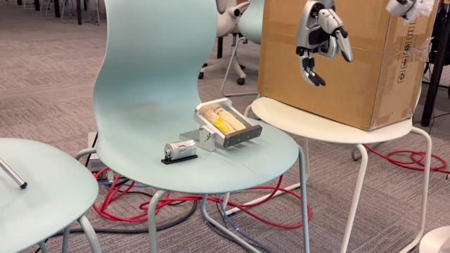
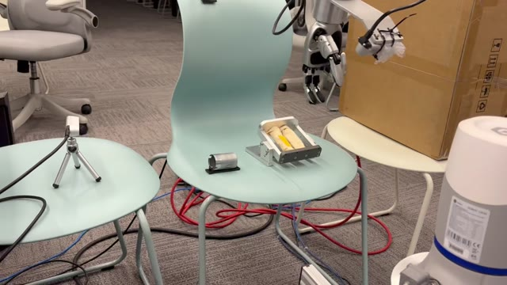

# OpenPI for Dobot CR3 + LinkerHand O6

This repository contains my Pi05 training and deployment work for a Dobot CR3 arm with a right-hand LinkerHand O6.

For the native OpenPI framework, general installation, supported models, and PyTorch instructions, see the [upstream OpenPI repository](https://github.com/Physical-Intelligence/openpi) and its [README](https://github.com/Physical-Intelligence/openpi/blob/main/README.md). This file focuses on the CR3/O6-specific work in this repository.

## Project-specific work

- Added `pi05_cr3_o6_lora` and `pi05_cr3_o6` training configurations in [`src/openpi/training/config.py`](src/openpi/training/config.py).
- Added CR3/O6 data transforms and robot interfaces under [`examples/cr3_o6`](examples/cr3_o6).
- Added training, policy-server, and robot-client commands for the CR3/O6 setup.
- Added two Pi05 motor recognition and grasping demonstrations.

## Pi05 demonstrations

### 电机正向识别抓取

[](https://moumde.github.io/openpi_for_cr3_o6/#forward)

Pi05 识别正向摆放的电机并完成抓取。

### 电机反向识别抓取

[](https://moumde.github.io/openpi_for_cr3_o6/#reverse)

Pi05 识别反向摆放的电机并完成抓取。

## CR3/O6 dataset and action format

The default dataset is [`dataset/data_v21`](dataset/data_v21). It contains three D435 RGB views recorded at 20 Hz: `base_0_rgb`, `left_wrist_0_rgb`, and `right_wrist_0_rgb`.

- CR3 state and action: 6 joint values in radians, using absolute joint targets.
- O6 state and action: 6 finger values in the raw `0–255` range.
- The dataset state/action size is 12. The Pi05 model uses `action_dim=32`; the CR3/O6 policy sends the first 12 output values to the robot.
- Default task prompt: `Pick up the motor and place it on the right side with the protruding side facing left.`

The dataset already includes [`norm_stats.json`](dataset/data_v21/norm_stats.json). If you change the dataset or regenerate its statistics, run this from the repository root:

```bash
uv run scripts/compute_norm_stats.py --config-name pi05_cr3_o6_lora
```

Keep CR3 values in radians and O6 values in `0–255` in the source dataset.

## Train Pi05

### LoRA fine-tuning

```bash
XLA_PYTHON_CLIENT_MEM_FRACTION=0.9 \
uv run scripts/train.py pi05_cr3_o6_lora \
  --exp-name=pi05_cr3_o6_lora \
  --overwrite
```

Checkpoints are saved under `checkpoints/pi05_cr3_o6_lora/pi05_cr3_o6_lora/<step>/`. Replace `--overwrite` with `--resume` to continue an existing run.

### Full fine-tuning

```bash
XLA_PYTHON_CLIENT_MEM_FRACTION=0.9 \
uv run scripts/train.py pi05_cr3_o6 \
  --exp-name=pi05_cr3_o6 \
  --overwrite
```

Checkpoints are saved under `checkpoints/pi05_cr3_o6/pi05_cr3_o6/<step>/`. Full fine-tuning requires substantially more GPU memory than LoRA; adjust the configured batch size to fit the available GPU.

## Serve a trained policy

The CR3/O6 helper script configures the CUDA `ptxas` path. For a LoRA checkpoint:

```bash
examples/cr3_o6/serve_policy_cuda.sh \
  --port 8000 \
  policy:checkpoint \
  --policy.config=pi05_cr3_o6_lora \
  --policy.dir=checkpoints/pi05_cr3_o6_lora/pi05_cr3_o6_lora/99999
```

For a full fine-tuning checkpoint, use its config and checkpoint directory:

```bash
examples/cr3_o6/serve_policy_cuda.sh \
  --port 8000 \
  policy:checkpoint \
  --policy.config=pi05_cr3_o6 \
  --policy.dir=checkpoints/pi05_cr3_o6/pi05_cr3_o6/<step>
```

The policy server listens on `ws://127.0.0.1:8000` by default.

## Run the CR3/O6 client

The client connects to CR3, the right-hand O6, and three D435 cameras. The NRC Python extension requires Python 3.12. These commands assume the `openpi` Conda environment and the LinkerHand SDK at `/home/je/code/linkerhand-python-sdk`:

```bash
conda activate openpi
export PYTHONPATH=/home/je/code/linkerhand-python-sdk:${PYTHONPATH:-}
export LD_LIBRARY_PATH=/home/je/anaconda3/envs/openpi/lib:${LD_LIBRARY_PATH:-}
```

Start with a preview that does not send robot actions:

```bash
python examples/cr3_o6/deploy_policy.py \
  --host 127.0.0.1 \
  --port 8000 \
  --robot-ip 192.168.2.14 \
  --preview-only \
  --duration-s 10
```

After confirming the preview, run the robot client:

```bash
python examples/cr3_o6/deploy_policy.py \
  --host 127.0.0.1 \
  --port 8000 \
  --robot-ip 192.168.2.14 \
  --confirm-motion \
  --initial-move-duration-s 5 \
  --max-joint-speed-rad-s 0.5 \
  --o6-speed 100 \
  --duration-s 60
```

The client powers the robot on automatically and returns it to its configured initial position at startup and shutdown. Press `Ctrl+C` to stop the client and run its return-to-initial-position routine. Verify the workspace is clear before enabling motion.

## OpenPI framework

This repository is based on [Physical Intelligence's OpenPI](https://github.com/Physical-Intelligence/openpi). See the [upstream README](https://github.com/Physical-Intelligence/openpi/blob/main/README.md) for general environment setup, model checkpoints, inference examples, and framework documentation.
